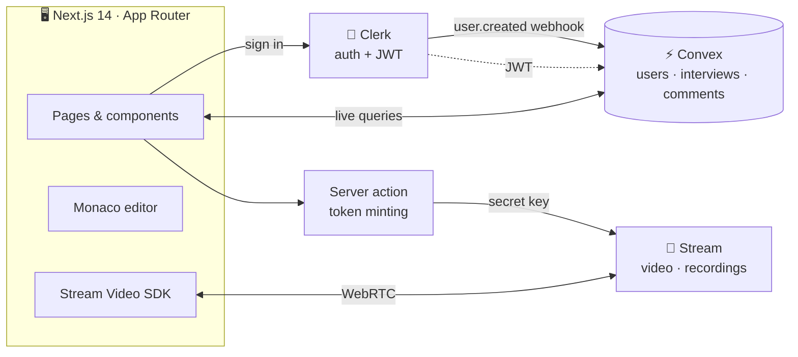
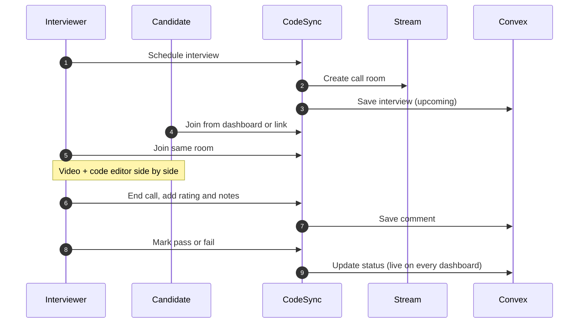

<div align="center">


<p>
  
  
  
  
  
  
  
</p>

<p>
  <b>
    <a href="#-overview">Overview</a> ·
    <a href="#-features">Features</a> ·
    <a href="#-engineering-highlights">Highlights</a> ·
    <a href="#-architecture">Architecture</a> ·
    <a href="#-getting-started">Getting Started</a> ·
    <a href="#-deployment">Deployment</a>
  </b>
</p>

</div>

<br />

## 📌 Overview

**CodeSync** is a full-stack platform for running remote technical interviews. Interviewers schedule sessions, candidates join from a link, and both sides meet in a single room that puts HD video next to a full code editor with curated problems.

After the call, interviewers rate the candidate, leave written feedback, and mark the outcome, all from one dashboard that updates in real time.

<br />

## ✨ Features

<table>
  <tr>
    <td width="50%" valign="top">
      <h3>🎥 Video Interview Rooms</h3>
      HD calls powered by Stream, with speaker and grid layouts, a participants panel, and a camera and mic preview before joining.
    </td>
    <td width="50%" valign="top">
      <h3>💻 Built-in Code Editor</h3>
      Monaco, the engine behind VS Code, in a resizable split view beside the video, with problems in JavaScript, Python and Java.
    </td>
  </tr>
  <tr>
    <td valign="top">
      <h3>📅 Interview Scheduling</h3>
      Pick a candidate, one or more interviewers, a date and a time slot. The call room is created ahead of time and linked to the interview.
    </td>
    <td valign="top">
      <h3>📊 Interviewer Dashboard</h3>
      Interviews grouped into upcoming, completed, succeeded and failed, with one-click pass or fail.
    </td>
  </tr>
  <tr>
    <td valign="top">
      <h3>⭐ Ratings & Feedback</h3>
      Interviewers leave a 1 to 5 star rating and written notes on every interview, visible to the whole panel.
    </td>
    <td valign="top">
      <h3>📼 Recordings</h3>
      Past sessions are listed on a recordings page, ready to replay or share with the hiring team.
    </td>
  </tr>
  <tr>
    <td valign="top">
      <h3>👥 Role-based Experience</h3>
      Candidates see their own interviews and a join button. Interviewers get scheduling, the dashboard and instant calls.
    </td>
    <td valign="top">
      <h3>🌗 Light & Dark Mode</h3>
      A clean shadcn/ui interface with a theme toggle that follows the system setting by default.
    </td>
  </tr>
</table>

<br />

## 🧠 Engineering Highlights

| Decision | Why it matters |
|:---|:---|
| **Signed webhook user sync** | Clerk's `user.created` webhook is verified with Svix signatures before a user is written to Convex, so forged requests are rejected. |
| **Idempotent sync** | The sync mutation skips users that already exist, so retried webhook deliveries never create duplicates. |
| **Server-side video tokens** | Stream user tokens are minted in a Next.js server action. The Stream secret never reaches the browser. |
| **Reactive data layer** | Convex queries are live subscriptions. When an interviewer marks a result or adds feedback, every open dashboard updates without a refresh. |
| **Indexed lookups** | Every hot path has a Convex index: users by Clerk ID, interviews by candidate and by call ID, comments by interview. |
| **Typed end to end** | Convex generates types from the schema, so the frontend calls backend functions with checked arguments and return types. |
| **Authenticated backend** | Clerk issues JWTs that Convex verifies on each query and mutation, and protected functions reject unauthenticated calls. |

<br />

## 🏗 Architecture



<details>
<summary><b>Interview lifecycle</b></summary>
<br />



</details>

<details>
<summary><b>Data model</b></summary>
<br />

```ts
users       { name, email, image?, role: "candidate" | "interviewer", clerkId }
interviews  { title, description?, startTime, endTime?, status, streamCallId, candidateId, interviewerIds[] }
comments    { content, rating, interviewerId, interviewId → interviews }
```

</details>

<br />

## 🧰 Tech Stack

| Layer | Technologies |
|:---|:---|
| **Framework** | Next.js 14 (App Router), React 18, TypeScript |
| **Backend & Database** | Convex queries, mutations and HTTP actions |
| **Authentication** | Clerk, with Svix-verified webhooks |
| **Video** | Stream Video React SDK and Node SDK |
| **Editor** | Monaco Editor |
| **UI** | Tailwind CSS, shadcn/ui, Radix UI, Lucide icons, next-themes, react-hot-toast |

<br />

## 🚀 Getting Started

### Prerequisites

- Node.js 18 or later
- Free accounts on [Clerk](https://clerk.com), [Convex](https://convex.dev) and [Stream](https://getstream.io)

### 1. Install

```bash
git clone https://github.com/differentiatorX/CodeSync-project.git
cd CodeSync-project
npm install
```

### 2. Environment variables

Create `.env.local` in the project root:

```env
# Clerk
NEXT_PUBLIC_CLERK_PUBLISHABLE_KEY=pk_test_...
CLERK_SECRET_KEY=sk_test_...

# Convex (written automatically by `npx convex dev`)
CONVEX_DEPLOYMENT=dev:your-deployment
NEXT_PUBLIC_CONVEX_URL=https://your-deployment.convex.cloud

# Stream
NEXT_PUBLIC_STREAM_API_KEY=your_stream_key
STREAM_SECRET_KEY=your_stream_secret
```

### 3. Connect the services

<details open>
<summary><b>Clerk → Convex authentication</b></summary>
<br />

1. In Clerk, go to **JWT Templates → New template → Convex**, and keep the name `convex`.
2. Copy the template's **Issuer** URL.
3. Paste it as the `domain` in `convex/auth.config.ts`.

</details>

<details open>
<summary><b>Clerk webhook for user sync</b></summary>
<br />

1. Run `npx convex dev` once and note your deployment's `.convex.site` URL.
2. In Clerk, go to **Webhooks → Add endpoint** and enter `https://<your-deployment>.convex.site/clerk-webhook`.
3. Subscribe to the `user.created` event.
4. Copy the signing secret and add it in the **Convex dashboard → Settings → Environment Variables** as `CLERK_WEBHOOK_SECRET`.

</details>

### 4. Run

```bash
# Terminal 1 · Convex backend with live sync
npx convex dev

# Terminal 2 · Next.js app
npm run dev
```

Open **http://localhost:3000** and sign up.

### 5. Become an interviewer

Every new account starts as a **candidate**. To unlock scheduling and the dashboard, open the **Convex dashboard → Data → users** and change your `role` to `interviewer`.

<br />

## 📁 Project Structure

```
CodeSync-project/
├── convex/
│   ├── schema.ts            Tables and indexes
│   ├── users.ts             User sync and lookups
│   ├── interviews.ts        Scheduling and status updates
│   ├── comments.ts          Ratings and feedback
│   ├── http.ts              Clerk webhook endpoint
│   └── auth.config.ts       Clerk JWT provider
│
├── src/
│   ├── app/
│   │   ├── (admin)/dashboard     Interviewer dashboard
│   │   └── (root)/
│   │       ├── (home)            Role-aware home page
│   │       ├── meeting/[id]      Interview room
│   │       ├── schedule          Scheduling UI
│   │       └── recordings        Past sessions
│   ├── actions/             Stream token server action
│   ├── components/          Meeting room, editor, cards, dialogs, shadcn/ui
│   ├── constants/           Coding problems, languages, time slots
│   └── hooks/               Calls, meeting actions, user role
│
└── public/                  Language icons
```

<br />

## ☁️ Deployment

Deploy the frontend to **Vercel** and the backend to **Convex** in one step.

| Setting | Value |
|:---|:---|
| **Build command** | `npx convex deploy --cmd 'npm run build'` |
| **Environment** | `CONVEX_DEPLOY_KEY` from the Convex dashboard, plus the Clerk and Stream keys |

After deploying, point the Clerk webhook at your production `.convex.site` URL and set `CLERK_WEBHOOK_SECRET` in the production Convex deployment.

<br />

## 🗺 Roadmap

- [x] Video interview rooms with layouts and device preview
- [x] Scheduling with multiple interviewers
- [x] Ratings, feedback and outcome tracking
- [x] Call recordings
- [ ] Live collaborative editing, so both sides see the same code
- [ ] In-browser code execution with test cases
- [ ] Interviewer-managed question bank
- [ ] Email reminders for scheduled interviews
- [ ] Role management from inside the app

<br />

## 🤝 Contributing

Contributions are welcome.

1. Fork the repository
2. Create a branch: `git checkout -b feat/your-feature`
3. Commit using [Conventional Commits](https://www.conventionalcommits.org): `git commit -m "feat: add code execution"`
4. Push and open a pull request

<br />

<div align="center">

**Built by [differentiatorX](https://github.com/differentiatorX)**

If you found this project useful, consider giving it a ⭐


</div>
